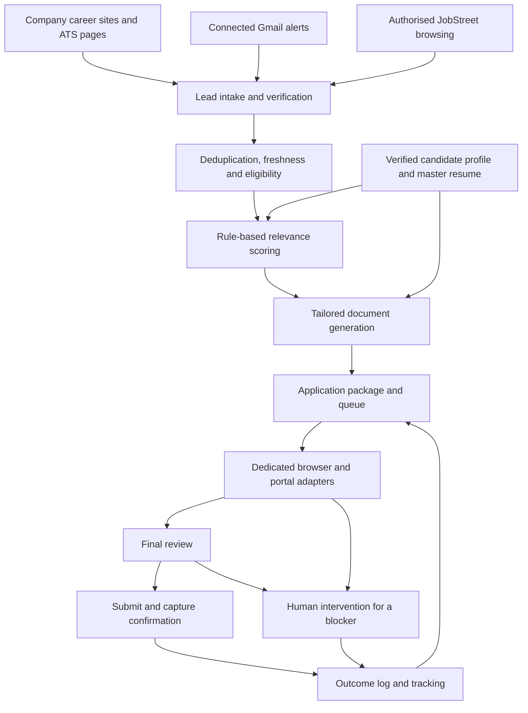

# JobBot | Personal AI Job Application Agent

**From a job lead to a tailored application, with explicit rules, browser execution and an auditable outcome.**

Built by [Rahul Balasani](https://github.com/rahulvrs1234) for my own Singapore job search, using Python and OpenAI Codex to assist development and operation.

This repository presents the architecture, workflow and engineering lessons from my personal application system. The implementation and operational records remain private. This is a documentation showcase, not an installable package or a shared job-application service.

## Why I built it

My search involved many repeated steps: reading alerts, checking employer websites, comparing requirements with my background, preparing documents, entering the same facts across different portals and tracking what actually happened. A generic resume and a spreadsheet alone did not connect these steps.

I wanted a workflow that could help me find relevant opportunities and complete applications while preserving truthful answers, my sponsorship requirements and a clear record of blocked or incomplete work.

The design follows a simple rule: **a promising lead is not yet an eligible application, and a click is not yet a confirmed submission.**

## What the workflow does

| Stage | Behaviour | Output |
| --- | --- | --- |
| Discover | Reads connected Gmail job alerts and checks company career sites; handles authorised JobStreet applications through the dedicated browser | Candidate leads with source links |
| Verify | Checks employer identity, Singapore location, full description, posting freshness, live Apply action and duplicate history | Verified opportunity or a recorded rejection reason |
| Match | Compares job descriptions with verified skills and experience using a rule-based relevance score | Score and reasons for inclusion or exclusion |
| Tailor | Produces a role-specific resume and cover letter using the verified master resume and profile | ATS-readable resume PDF, cover letter and document audit |
| Prepare outreach | Creates hiring-manager messages and HR email text | Drafts for review |
| Fill | Uses browser automation to upload documents and complete supported application fields | A completed form or a precise blocker |
| Review and submit | Checks mandatory answers, documents and eligibility; submits eligible applications when the final state is clear | Visible confirmation or an unverified/blocked state |
| Track and resume | Maintains CSV trackers, package indexes, outcome logs and pending work | Spreadsheet-readable history and a continuation queue |

The workflow can fill contact information, education, work history, field of study, availability, salary expectations and sponsorship answers when the portal wording maps clearly to verified profile facts. It attaches the tailored resume and cover letter where the portal provides an appropriate upload field. Missing or ambiguous answers are escalated rather than invented.

The configured submission threshold is **60/100**. This is a job-to-profile relevance threshold, not a percentage accuracy score or an estimate of hiring probability. Passing it still requires the separate verification and eligibility checks. Earlier versions used different screening defaults; the submission policy is an additional gate.

## My ownership and use of AI

I initiated the project, defined the job-search requirements and candidate facts, selected the operating policies, exercised the workflow against real portals, reviewed failures and drove iterations. I specified how the system should handle sponsorship, job freshness, duplicate applications, document tailoring, browser isolation and submission confirmation.

I used OpenAI Codex extensively to help write and modify Python, develop browser helpers, debug portal interactions, generate documentation and operate the workflow. I reviewed behaviour and corrected incomplete fields, mistaken outcome reports and browser-session problems. This was AI-assisted development and operation; the project should be understood with that division of responsibility.

## Architecture

Python modules handle intake, ranking, package generation and policy checks. Pandas and CSV files provide simple, inspectable state. YAML stores verified candidate facts and policy settings. Resume generation selects and reorders existing content, creates LaTeX and compiles PDF output. Browser automation uses Playwright/CDP and portal-specific helpers in a dedicated persistent Chrome profile.

Codex provides assistance with research, interpretation, implementation, debugging and browser workflow execution. The inspected local tailoring modules also use deterministic templates and matching rules; not every stage requires a model call. The architecture does not assume a custom trained model or an agent framework that was never implemented.

## Where I use code, AI and human review

| Decision | Approach | Reason |
| --- | --- | --- |
| Duplicate IDs, dates and numeric thresholds | Deterministic code | Repeatable comparisons should not depend on model judgement |
| Candidate facts and eligibility answers | Verified structured profile with explicit rules | An application must not invent experience or work authorisation |
| Role interpretation and document emphasis | AI assistance plus source-based checks and templates | Wording varies, but evidence must remain grounded |
| Uploading and navigating forms | Browser automation and portal adapters | Real portals require interaction with visible controls |
| CAPTCHA, verification and unfamiliar declarations | Human handoff | These are explicit boundaries of unattended execution |
| Submission reporting | Confirmation evidence and actor tracking | Manual and automated completion must remain distinguishable |

## Failures that changed the design

The most useful lessons came from operating the system, not from the happy path.

- **Empty structured fields:** A document upload did not guarantee that work experience or field of study appeared in the employer's review page. The workflow gained final-review checks for missing responses and explicit structured-field entry.
- **Wrong browser session:** Opening a link in the wrong Chrome profile broke session continuity. The dedicated launcher now verifies the profile and automation endpoint before attaching. The normal browser is excluded from the workflow.
- **False attribution of submissions:** A confirmation seen later could belong to an application I completed myself. The reporting rule now distinguishes `user_submitted` from an agent submission; the latter requires the same run to submit and observe confirmation.
- **Repeated portal blockers:** Loading overlays, expired sessions, CAPTCHA and Workday errors interrupted applications. The design records specific blockers and preserves pending work instead of counting attempts as success.
- **Incomplete email intake:** Finding alert messages was not the same as processing their job leads. The workflow specification now requires each extracted role to be queued or given a recorded disposition before intake is marked complete.

See [failure analysis](docs/failures-and-guardrails.md) for implementation evidence and remaining gaps.

## Results and evaluation

The system has been used in my real personal job search to prepare application packages, fill supported forms, record submissions and surface blockers. The private project contains generated resumes, cover letters, spreadsheet-readable trackers and application audit records.

I do not present raw log-row totals as unique applications: retries, blockers, legacy status labels and manual submissions need reconciliation. I also do not claim a measured accuracy rate, time saving, interview conversion lift or commercial scale without a verified baseline.

The local test suite covers eligibility conflicts, role matching, freshness validation, document tailoring, final-review blockers and submission provenance. **All 54 existing tests passed on 17 November 2026.** Tests of those functions do not establish that every external portal will work unattended. Current validation notes and illustrative tracker states are in [evidence and limitations](docs/evidence-and-limitations.md).

## Current scope and production gaps

This is a personal system used against live services. Portal changes, missing credentials, verification challenges and unknown answers still require intervention. Daily targets are goals, not guaranteed outputs. The local implementation includes legacy defaults and older documentation that need consolidation with the newer policies.

Before offering this as a service to other users, I would need stronger portal contract tests, a unified state store, idempotent submission handling, formal evaluation datasets, central monitoring, access controls for multiple users and a deployment model with clearly defined recovery behaviour.

## What is shared here

This showcase shares documentation only. The source, candidate profile, real trackers, browser data and generated personal application documents stay private. No credentials, session cookies, mailbox contents or other people's data are included. Examples are illustrative and explicitly labelled.

For a technical discussion, I can walk through the design decisions, actual failure cases and sanitised evidence without distributing the private implementation.

**Author:** Rahul Balasani · [GitHub](https://github.com/rahulvrs1234) · [Portfolio](https://rahulbalasani.me)
